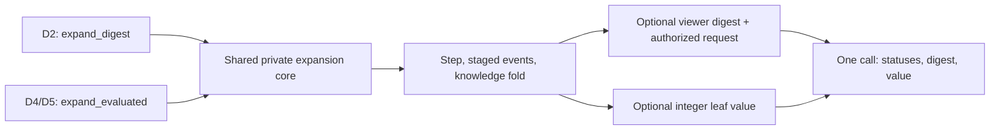

# In-engine evaluation and the viewer observation digest

**Status: proposed; owner and HS approval required before implementation.** Issue [#485](https://github.com/chrismaghuhn/duoforge/issues/485),
[#450](https://github.com/chrismaghuhn/duoforge/issues/450) piece 2, and the D4 hook of
[depth search](2026-10-13-depth-search-design.md), sections 4.2, 6.3, 7.3 and Q3.
The owner has paused restructuring after field PR #487. This is a documentation PR: no engine build,
benchmark, export, training, checkpoint conversion or private-data run is performed here.

The goal is to reach D5, the sampled three-turn tree, quickly while keeping its gates. The digest ships first,
so D2 need not wait for a trained evaluator. The value kernels and private distillation can then proceed in parallel
after their respective approvals. **D4 remains `evaluator="jax"` until the engine evaluator passes its gates.**
Merging this document does not by itself authorize a training run or live adoption. **Every E4 training run needs
its own explicit owner go**, including retries and further runs of an already approved architecture. HS merges every PR.

## 1. Decisions and scope

| Question | Proposed decision | Reason |
|---|---|---|
| API | `duoforge_batch_expand_digest` and `duoforge_batch_expand_evaluated`, sharing one private core; preserve `duoforge_batch_expand` | Early D2 delivery and one digest/value call for D5, with no ABI break |
| Early delivery | The sibling works without a model, producing digests and optionally encoder rows | Unblocks D2 before the network exists |
| Network | Compare at least full BC6 in C, a small distilled network and a medium network; all batch the 16 worlds | Do not choose the size before measuring strength at equal time, with an equal-budget control |
| Arithmetic | Quantized integer inference, including deterministic fixed-point LayerNorm for full BC6; fixed-point value | Byte-identical inference across MSVC, GCC and Clang; numeric fidelity is gated for the BC6 conversion and reported for distilled networks |
| Inputs | The existing viewer-specific encoder-6 observation of each world, 16-world tiles | Same information as the JAX teacher, no second battle-rule implementation |
| Memory | Immutable loaded model and one preallocated workspace per worker | No allocation or resizing while expanding/evaluating leaves |
| Weights | Private, versioned binary artifact; mandatory expected full-file SHA-256 | No embedded trained weights, checkpoint or public CI artifact |
| Adoption | Candidate-specific section 9 gates and common arithmetic gates, then a strength-at-equal-time ladder and existing search/latency gates | Distilled networks may trade accuracy for depth; throughput alone cannot select a network |

Root and intermediate candidate policies, the foe model, world sampling, the root rule (including adopted
lambda) and CFR+ arithmetic remain those of the search lane. Fixed-budget comparisons keep its budgets identical;
equal-time arms use predeclared work budgets, not a changed solver. This proposal replaces **leaf value inference**.
It does not port policy or team heads, implement the D5 sampler, change timers, or start selfplay.

All variants recompute from each leaf's observation. **Incremental NNUE-style updates are not a goal**:
too much changes in a doubles turn. There is no planned accumulator or delta-update stage.
Value inference removes the per-leaf JAX value call and host row transfer. It still constructs features in C;
it does not promise to make feature construction free. D5's policy-prior acquisition has its own cost: cached/batched
BC6 policy work is reported separately, and this spec does not claim to remove all JAX calls from an entire decision.

## 2. Inspected contracts and provenance

Repository inspection: **main `b41153670f1e52e3b503229aee48dd97e4007fbb`, dirty=false**, after #487.
These are source facts, not timing results.
The D2 interface was read, without checking out or changing that lane, at
**`search/d2-tree@11b7797e5c806c5ba44cdc0669c57b5e8b0a8918`**; the subsequent observation-digest draft was read at
**`060ef58dbe3b7bd84f703f9109479d1d1b550837`**. HS reserved decision **0082** for that coordination.
Its contract is provisional until that PR merges;
reconcile wiring with its merged version before the first integration PR, without changing the solver.

- `src/search/search.c`, `dfi_expand_leaf`: clone, reseed, step, exact terminal result or viewer encoding.
  Its RNG seeds depend on `(seed, key, sample)`, not workers, choices, chunks or leaf positions.
- `include/duoforge/duoforge_search.h`: the existing expansion signature, output shapes and refusal order.
- `src/combat/events.c`, **`dfi_events_fold_knowledge`**: the knowledge fold after the field step.
  `src/combat/events.h` declares it. It was not moved to `src/combat/field/` or a Python tracker.
- `src/state/request.c`, the step path: folds staged events after turn execution; team selection folds leads
  with `first=0`, then entry effects and the turn line with `first=leads`. Move rows can be amended before this fold.
- `dfi_event_project`: own HP exact, foe HP displayed as percentages, Illusion side-channel bytes stripped.
- `src/encode/encode.c`: existing controlled IEEE-754 encoder, shared with JAX input construction.
  Encoder 6 has **1,094 observation columns**; `columns.columns` groups them into global `(36,)`, side `(2,29)`,
  position `(2,2,105)`, member scalars `(2,6,32)` and categorical/occupant groups.
- `python/duoforge_learn/model_v2.py`: teacher preset M has embedding 64, member/position 128,
  hidden 640 and three torso layers with LayerNorm. `policy.Model.value` needs no policy or slot outputs.
  The adopted search documentation identifies the teacher as **BC6-M, encoder 6**; the private artifact supplies
  the full checkpoint digest, feature mask and actual configuration, rather than relying on that nickname.

D2's [`evaluator.py`](https://github.com/chrismaghuhn/duoforge/blob/11b7797e5c806c5ba44cdc0669c57b5e8b0a8918/python/duoforge_search/evaluator.py)
uses `leaves(source, seed, keys, viewers, root_envs, samples, choices, cut, costs=None)` and returns
`Leaves(values, step, encode, results, tiebreaks)`. Values are `(n,)` float32; the other arrays are uint32.
Its [`infokey.py`](https://github.com/chrismaghuhn/duoforge/blob/11b7797e5c806c5ba44cdc0669c57b5e8b0a8918/python/duoforge_search/infokey.py)
uses `keys(nodes, envs, viewer, closed) -> (uint8[n,32], bool[n])`. The boolean marks refused keys.
Both unavailable engine capabilities currently refuse by name. These interfaces and `tree.py` remain unchanged.

## 3. Sibling APIs with one private expansion core

The following is the proposed additive contract, not a header change in this PR. Opaque evaluator/workspace handles
have cold load/create/destroy operations. No new event, cause or view-feature number is needed.

```c
typedef struct duoforge_evaluator duoforge_evaluator;
typedef struct duoforge_eval_workspace duoforge_eval_workspace;
typedef struct duoforge_eval_error {
    uint32_t leaf; /* selected failing index; UINT32_MAX for preflight */
    char phase[16];
    char reason[128]; /* bounded ASCII, names the unclassified entry */
} duoforge_eval_error;

duoforge_status duoforge_batch_expand_evaluated(
    duoforge_batch *leaves, const duoforge_batch *roots,
    uint32_t version, uint64_t ext_supported, uint64_t seed,
    const duoforge_request *root_requests,
    const duoforge_factored_domain *root_domains,
    const uint64_t *keys, const uint8_t *viewers,
    uint32_t count, const uint32_t *root_envs,
    const uint32_t *samples, const duoforge_factored_choice *choices,
    duoforge_status *step_statuses, duoforge_status *encode_statuses,
    duoforge_step_result *results, uint32_t *leaf_results, void *obs,
    uint8_t *digests, duoforge_status *digest_statuses,
    const uint8_t *cut, uint32_t *tiebreaks,
    const duoforge_evaluator *model, duoforge_eval_workspace *workspace,
    duoforge_status *eval_statuses, int32_t *values_q,
    duoforge_eval_error *out_error);
```

`duoforge_batch_expand_digest` is a thin digest-only convenience wrapper: the legacy argument list plus `digests`,
`digest_statuses` and optional `out_error`; it forwards to the same private core with no model/workspace/value
outputs. The extra digest status is needed for an observation/request-projection failure after a successful step;
it must not be mislabeled as a failed battle step. This refines the D2 draft's minimal output-only suffix.
Both siblings reuse the clone/reseed/step core, not two copies of rule execution. Digest-first E1b requires no model
implementation. D4/D5 use **one** evaluated call for digest and value, not two expansions of a stochastic leaf.



`version`, mask, roots, requests/domains, viewers and seeding mean exactly what they mean in the legacy call.
Digests are `count * DUOFORGE_DIGEST_SIZE` bytes, contiguous, one selected root viewer per leaf. Every status/result
array has `count` entries. In the evaluated call, `digests`/`digest_statuses` may both be NULL to omit digest work;
when either is present, both are required. The digest wrapper requires both for count > 0.
`obs`, when present, has the legacy row shape and alignment. Arrays beyond `count`
are untouched. Inputs and outputs must not overlap; roots remain read-only during the call.

| Mode | Model/workspace | Row output | Value output | Use |
|---|---|---|---|---|
| Digest plus JAX inputs | both NULL | caller-provided `obs` | both value arrays NULL | D2 node expansion; JAX evaluation remains available |
| Digest only | both NULL | NULL | both value arrays NULL | Observation identity or terminal-only probes |
| Digest plus engine value | validated handles | optional `obs` for parity probes | required `eval_statuses`, `values_q` | D4 and later D5; production passes NULL rows |

Engine value without a digest is also valid when the caller already holds that step's key; no observer runs.
The combined mode is the D5 contract. With count > 0, at least one of rows/digests/values must be requested.

Model NULL with value outputs is invalid, not a request to write a zero valuation. Model non-NULL needs a workspace;
for count > 0 it also needs both value buffers. `cut` and `tiebreaks` are either both present or both NULL.
When present they provide the existing exact tiebreak for successful nonterminal cut-off leaves. TERMINAL takes
precedence; off-cut and terminal tiebreak entries are zero. The already used D2 unresolved-tiebreak sentinel is
returned for `duoforge_battle_tiebreak`'s `E_UNSUPPORTED`; other tiebreak errors are propagated, not scored.

Preflight checks preserve the legacy ordering for existing arguments: required pointers, matching context,
encoder/version mask, distinct batches and valid indices/viewers. Then validate model context/schema/mask,
workspace ownership, worker count, capacity and output-size arithmetic before touching any leaf.
Workspace exhaustion returns existing **`DUOFORGE_E_CAPACITY`**, naming `eval_workspace_capacity` in the binding.
Count zero is valid, with array pointers NULL, after global checks. Unknown configuration or unsupported schema
is explicitly refused; no resizing, truncation or implicit JAX backend switch occurs.

Per-leaf step/terminal/encoder behavior stays that of the legacy expansion:

- A refused step leaves the leaf as the copied/reseeded root under the existing atomic-step contract;
  results/rows/value/digest outputs are cleared and the digest is invalid. It cannot inherit the root's old digest.
- A successful TERMINAL emits a valid digest and exact `leaf_results`; no network is called.
- A successful cut-off leaf emits a digest and exact tiebreak; no network value is consumed.
- Other successful leaves are observed/validated with the existing encoder and, in engine mode, valued once.
  Value units are `values_q / 2^20`, from the selected viewer, not averaged over worlds or policy candidates.
- An observation/encoding refusal is distinct from a step refusal. An inference refusal has a nonzero
  `eval_statuses[i]`, not a plausible zero score. Nonconsumed values are zero with successful phase statuses.
  A valid zero value is distinguished by status. Failed digests likewise have a status, not a zero-byte sentinel.
- A post-step digest/encoding/inference failure does not roll back a successfully stepped leaf, just as a legacy
  encoder failure does not. Preflight failures touch nothing. No invalid digest/value is published as valid.

The call returns the lowest-index failing step status, then digest status, then encoding/tiebreak status, then
evaluation status. Worker completion order cannot choose the error. Per-leaf arrays retain all outcomes.
Optional caller-owned `out_error` receives that same selected failure's phase and reason (empty on success),
including the event/variant name for an unclassified row. Workers collect bounded diagnostics privately;
publication happens after joining, with no shared mutable last-error buffer or new numeric error namespace.
Cold load/workspace operations use the same diagnostic convention.
The binding retains the existing refusal policy: unsupported **battle steps** follow D2's candidate-drop rule;
digest failures mark refused information keys; model/encoding/inference failures are named errors, never losing
payoffs or silently dropped training/test rows.

### 3.1 Python wiring without changing the tree

`EngineEvaluator.leaves(...)` implements D2's existing interface; it calls the sibling once per planned chunk,
checks extra phase statuses and returns the same `Leaves` tuple. Convert fixed-point integers to float32 by the
specified correctly rounded power-of-two scaling at the adapter boundary. Preserve exact terminal/cut-off treatment
in the existing tree, and its `costs` keys; an additional breakdown may live outside the solver.

`DigestKey.keys(...)` reads a preallocated sidecar filled by that same sibling call. An opt-in node-batch adapter
routes node expansion to the sibling without a model, keeps the existing expansion return tuple and forwards other
Batch operations. Construction/factory wiring changes, not `tree.py`, the game solve, or its evaluator/key interfaces.
The ordinary `Batch.expand` and default depth-1 path continue using the unchanged legacy API.

The sidecar is per batch environment and viewer, with valid bits and an expansion generation. Overwriting/copying
an environment invalidates its old key; viewer/generation mismatches refuse. It is allocated at construction,
not saved in battle state, public records, or the codec. D2 reads it after expansion; it cannot reconstruct the
step's event digest from a final observation. Chunking stores each digest by its **logical** node index before a
scratch environment is reused. D5 keeps parent key, action and new digest for perfect recall, as spec 4.2 requires.

## 4. Observation digest: authoritative stream and exact fold

**The observation digest is not a state digest, public-record digest, encoded-row digest or RNG digest.** Those
would reveal filled-in particle facts or merge different histories. It hashes the selected viewer's visible rows
of this single expansion step, in their original order, whether or not a row changes a knowledge byte.
Own-side rows, field-wide rows and terminal announcements count too. The visible request at the new boundary
is appended separately, not invented as a new event. Event history alone is not the complete current request.

The unchanged leaf path is `dfi_expand_leaf -> duoforge_battle_step -> dfi_battle_step_events_tape` in
`src/state/request.c`. A private viewer/observer variant belongs there, with its existing staged events and atomic
commit. **D4 does not move the fold** to field headers or inference. Old public step functions and
the legacy expansion pass NULL; the sibling enables it. In `dfi_events_fold_knowledge`, consume the projected row
**after `dfi_event_project` and before kind-specific `continue` branches**, only for `i >= first`.
Maintain one streaming SHA-256 state for the requested viewer across the two team-selection fold windows.
Earlier prefix rows may still update occupant tracking, but are never hashed again. Ordinary steps consume `[0,count)`.
Hash final staged rows, not `dfi_events_push`'s provisional MOVE row: retargeting and flags may be amended later.
Publish the 32-byte result only after the complete step passes invariants and commits.

### 4.1 Canonical bytes, including visible identity

Use a private, versioned canonical **line encoding**, not raw `sizeof(duoforge_event)` memory:

1. The D2 draft's ASCII domain `duoforge.observation-digest.v1`, a zero byte, and the viewer as one byte.
2. For each visible projected row, a little-endian uint32 byte length followed by its canonical payload.
3. The row count as little-endian uint32, then a length-delimited canonical **authorized request projection**:
   boundary kind, public request mask, public requested-slot masks, and the selected viewer's own displayed request
   data/options, as detailed in section 4.3.
4. SHA-256 finalization, with no state/world/seed/worker metadata appended.

Payload fields follow the existing public event's documented line semantics. Scalar widths/order and
little-endian encoding are frozen by independent golden vectors. Reserved bytes and struct padding are absent;
fields that carry no visible information for that kind are absent, rather than serializing internal scratch.
The serializer explicitly covers every supported event kind and its flag/cause variants; an unclassified kind
or variant is `E_UNSUPPORTED` with `observation_line_unclassified`, naming the entry. No default hash of raw bytes.
Its schema is private and versioned; it assigns no public gameplay ids.

Roster indices need special care. SWITCH/DRAG and named bench operations such as REVIVE stand for visible identities,
not arbitrary particle slot numbers. Encode the shown species/forme/gender and canonical side/position or already
observed identity as the line requires; resolve Illusion's displayed identity, never its hidden holder.
Two distinct shown species at the same roster index must differ; a particle's renumbering of the same visible
identity must not. Do not include unrevealed bench species, ability, item, stat points, HP maxima or PP.
Exact own HP and displayed foe HP/colour follow the existing projection.

Resolution is **at the row's time**, not a lookup in the final leaf. A SWITCH followed by MEGA must retain its
original switch identity. If the existing staged row lacks an immutable visible payload, capture that payload in
a bounded **private sidecar** when the row is staged, using the existing event producer's display information.
The observer serializes it with the finally amended row at the fold. The sidecar is bounded local stack storage
in model-NULL mode, and reused preallocated worker workspace storage in value mode; it is neither a new public
event nor a state field. A public event amendment must keep its
visible sidecar consistent. This is a line-identity plumbing task, not new visibility logic in Python.

The implementation PR freezes the complete payload schema with an independent protocol-line oracle from public
reference fixtures before approving it. A bare projected 20-byte record is insufficient as that oracle: an index
alone does not tell which species a switch showed. No display string contains a bot/player nickname, match id or user id.

### 4.2 Stack, collision and identity guarantees

The result is **32 bytes on the stack per active leaf**. Streaming SHA-256 also needs a bounded block buffer,
counters and compression scratch; claiming the entire hash uses only 32 bytes would be incorrect.
Extend the existing private `src/core/sha256.c` with init/update/final primitives and retain the one-shot wrapper's
golden behavior. No heap, full transcript buffer or mutable global hasher is introduced. The canonical identity
sidecar is bounded scratch, as above. All temporary sizes are included in the memory gate of section 7.

Equal canonical visible streams and requests for the same viewer give equal digests, irrespective of unseen facts
and scheduling. Different visible
streams are expected to differ under SHA-256's collision assumption, not a mathematical collision-free guarantee.
Algorithm/schema identity belongs in search provenance, outside the per-step stream. Root public information and
own past actions remain in the tree's information-set key; for three turns it chains `(parent key, action, digest)`.
The request/domain at a leaf continues to be queried and validated by the engine. The digest contains only that
viewer's authorized request, never the foe's domain. It is not an oracle for hidden options, a substitute for
legality checks, or a promise that no SHA collision exists.

**Digest gate (E1):** independent golden line streams; all public reference battles, both viewers; event-order,
damage-display, switch-identity and move-amendment mutations; and metamorphic hidden-world tests. In particular:

- Same projected history and visible request with different hidden foe stat points/HP maxima/RNG state yields equal digest.
- Different displayed HP/colour, switch identity or event order yields different digest in the pinned fixtures.
- Particle roster renumbering and differing hidden Illusion holders do not split identical shown histories;
  a visible Illusion break can split them. SWITCH then MEGA hashes each identity at its correct time.
- Team-selection prefixes are consumed once; fields and own-side rows are included, even if knowledge ignores them.
- One/four/eight workers, chunk sizes 1/7/16 and reordered leaf placement give identical per-logical-leaf digests.
- Refused steps/overflow never expose a valid key. Legacy reference state/request/event/RNG digests and test
  assertions stay unchanged; old symbols and layouts remain compatible. D2 uses the real key, not a record fallback.

### 4.3 Answers to D2 and decision 0082: what the request adds

The D2 draft is `docs/superpowers/plans/2026-10-14-observation-digest-draft.md` on the inspected D2 branch.
This section is Astra's proposed agreement for HS, not an edit or merge of that lane's draft.

1. **Step location: yes.** `dfi_battle_step_events_tape` remains the entry point with `dfi_events staged`.
   A private variant with viewer/digest observer is appropriate. Fold final projected records there, across the
   existing `first` windows, and append the request projection only after the full successful step. No fold relocation.
2. **Coverage: events plus just boundary kind/request mask are not enough to assert the full information set.**
   Decision 0007 section 6 defines history, while sections 2/4 also authorize own state and requests.
   `duoforge_request` additionally has `requested`, `slot_mask` and an own `candidate_count`; the factored domain
   supplies the actual selectable options. `src/state/request.c`'s `dfi_switch_trapped` check can remove own switch
   options. A silent trapping ability can therefore change the visible own request without a separate ability line
   or a different boundary/request mask. Equal candidate counts can also hide different available moves.
   This is a source-derived coverage requirement, not a measured counterexample claimed by this doc PR.
3. **API: two public conveniences, one private core.** Keep D2's `duoforge_batch_expand_digest` as the first delivery.
   Add `duoforge_batch_expand_evaluated` with optional digest outputs for D4; it returns values and digest in one call.
   They never each step the same leaf to obtain the two outputs. The old `duoforge_batch_expand` ABI stays untouched.

Canonical request payload comes from existing **viewer-authorized engine queries**, not the raw battle or a full
particle-filled public record. Include own requested/slot masks, displayed own HP/PP and move availability, selectable
own factored commands/pair mask and own team-selection fields where applicable, in the engine's stable order.
Use the already authorized own-side observation/extension fields needed for those displays. Boundary/request masks
of both sides are public by decision 0007; **foe candidate counts, domains, PP, unshown sheets, stat points and hidden
durations are excluded**. Omit global request epoch, struct padding, reserved bytes and internal slot-allocation
metadata. An epoch is a validation token, not an observation-history discriminator.

The exact field whitelist and bytes, including the visible identity normalization above, are frozen in E1a with
independent request/protocol vectors before E1b. Do not hash a full observation or encoder row to fill a coverage gap:
under CTS these contain particle-filled fields. For identical shared parent information/history/actions, paired
tests must establish that all authorized displayed own/request information agrees whenever the keys merge.
If an allowed display field is missing, extend that canonical request whitelist before release; do not silently
merge the nodes or infer a battle rule in Python.

Add negative controls: same event history and boundary/mask but different own requested slots or switch/move
availability must split; different private epochs and foe unshown options with the same visible request must not.
Request projection failure is a refused digest with a named phase/status. Failed steps still clear all 32 bytes;
successful steps may not use zero bytes as a valid-key marker. All three answers and the refinements to the draft
are subject to HS's approval of 0082/#485 before implementation.

## 5. Three network variants and their per-world inputs

**No network size is selected by this spec.** The comparison includes at least these three value-only candidates,
plus the frozen full BC6/JAX control. Every C candidate evaluates the same 16 worlds in tiles of at most 16 rows.

| Candidate | Required content | What the comparison tests |
|---|---|---|
| Full BC6 in C | The frozen teacher's entire value computation: categorical embeddings, masked move/member pools, member/position layers, all torso layers, LayerNorm and residual additions, linear value head; original dimensions and learned parameters | Cost and fidelity of moving the full network into C, without distillation or dropping an operator |
| Small distilled | A smaller value-only categorical/pooling network trained against that same frozen BC6 value | Whether reduced inference cost buys enough search to compensate for approximation |
| Medium, tile-16 | An intermediate-size value-only network distilled from the same teacher and bundled over all 16 worlds | The strength/time trade-off between the small and full candidates |

Omitting unused policy/team heads from the full candidate is value-only dead-code elimination, not a smaller value
network. Its dimensions are those of the pinned teacher artifact. Small and medium dimensions, depth, normalization
and residual choices remain open here. Before training/export or comparison results, an owner/HS-reviewed experiment
README freezes all three graph descriptors, dimensions, parameter counts, arithmetic versions, calibration/training
budgets and resource bounds. The medium must have an intermediate value-path parameter count, not be a renamed
small graph with a different scheduler. All three use tile-16 scheduling; scalar/tile comparisons isolate batching
from network size. Report a failed candidate explicitly; silently comparing only the two survivors is not this plan.
Changing a graph after seeing the held-out results requires a new declared experiment and untouched hold-out.

Present means move count above zero, not species id above zero (id zero is valid). Empty pools give zeros;
unregistered members and absent occupants retain the existing masks. IDs are categorical: never treated as
continuous species numbers, quantized before recovering them, clipped to a supported id, or silently remapped.
Column names/order, mask and id-table semantics are pinned in the artifact. Every column is classified once;
unknown columns cause a load/export refusal. These are learned-feature operations, not battle-rule logic.

First use the existing C observation/extension projection and encoder-6 row **inside** the worker, identical to
the teacher's row for that world/viewer/mask. Recover categorical ids before quantization using the same validated
mapping as `columns.check_ids`. Quantize scalars by a specified integer conversion of IEEE-754 binary32 bits
(via `memcpy`), with round-to-nearest, ties-to-even. Do not change the current encoder's scaling recipes.
This avoids a second implementation of visibility, HP, duration or status rules. A later fused integer encoder
must prove exact equality to these canonical quantized inputs on all fixtures before replacing this path.
Keep the binary32 bridge in the existing encoder files; the new value kernel consumes integer ids/bits/activations.
Do not broaden the core's floating-point lint exceptions to implement inference.

There are **16 worlds, evaluated individually and bundled into tiles of at most 16 rows**. Tile order is not an
arithmetic dependency. Partial tiles are masked, not treated as extra zero-valued leaves. World weights and
candidate/chance means remain fixed-order search operations outside the network. No mean-world feature vector,
hidden-state oracle row, cross-world normalization or batch-dependent layer is permitted.

The full candidate converts the frozen BC6 value-path parameters, without retraining or distillation. Its quantization
error is measured against the original JAX teacher, not relabeled as exact floating equivalence. Train the small and
medium candidates by supervised distillation of that same BC6 **value**, not game outcomes, search labels or selfplay
rewards in this step. Sources are the existing engine-accepted registry and pinned random-team/moveset generator; include
the observations used by accepted closed-sheet worlds. Unsupported generation/reconstruction is named and counted.
Split by game/team generation group before extracting rows; training, calibration and held-out gates are disjoint.
Quantization-aware training/calibration, seeds, optimizer/budget and teacher/file hashes are fixed in a private
run manifest before the run. **Each individual E4 training run requires a separate explicit owner go** for that
candidate and run manifest; a spec/architecture approval or an earlier training go does not cover later runs or
retries. No such run is authorized or executed by this spec PR.

Full BC6 in C is a mandatory comparison arm, not a fallback considered only if a small student fails. Candidate
selection follows section 10.1's strength-at-equal-time ladder, with equal-budget controls. Neither leaf throughput
nor parameter count alone chooses the winner. The BC6 policy/foe networks remain unchanged in all arms.

## 6. Deterministic integer inference

Choose **quantized arithmetic**, rather than platform floating reductions, for every comparison arm. This avoids
compiler/FMA/sqrt differences while keeping a scalar C17 oracle; quantization is still an approximation to BC6/JAX
and is assessed under section 9's candidate-specific rules. Do not claim cross-platform agreement merely from
similar final moves.

Use signed int8 dense weights/embeddings, signed int16 feature/activation storage, int64 biases and accumulation.
Full BC6's normalization parameters and pre-normalization tensors may need int32 fixed-point storage; their exact
scales/storage widths are part of its predeclared graph descriptor, not an implementation-dependent precision choice.
For each output channel, compute bias plus dot product in ascending input index; pool in roster/move order.
ReLU, registered masks, sums/maxima and integer requantization have one canonical order. Quantization scales are
positive integer multipliers plus power-of-two shifts, with a signed round-to-nearest/ties-to-even definition.
Specify negative rounding using unsigned magnitudes; never rely on right-shifting a negative signed integer.
Each activation tensor has one common scale; rescale embedding/scalar/pool branches to the destination tensor's
scale before concatenation, with the same explicit rounding/saturation nodes in the quantized training oracle.
Per-output-channel weight scales are requantized back to that common activation scale after each dense layer.
Pool sums accumulate wide before their specified requantization. Tensor scales and those rounding points are
part of the immutable graph, not inferred differently by each kernel.

**Full BC6 operator coverage:** retain each LayerNorm's learned gamma/beta, its epsilon and the teacher's
`dense -> LayerNorm -> ReLU` order; the first torso layer replaces the input, later layers add their residual.
For a normalization vector, compute its sum in ascending channel order and round the division by channel count
once, ties-to-even. Compute squared deviations from that fixed-point mean in wide checked integers, sum in the
same order, and round the variance division once. Quantize the teacher's binary32 epsilon (`1e-5`) to a declared
positive variance-scale integer; a scale that rounds it to zero is invalid. Use a portable integer square root
with a specified output scale and correctly rounded result (adjacent-square comparison), then explicit ties-to-even
division for normalization, multiplication by gamma and addition of beta. All rescaling/rounding points, residual
addition bounds and saturation sites are recorded in the graph and export oracle. No platform `sqrt`, epsilon
omission or replacement of LayerNorm by a different layer. Preserve the teacher's masks, gathers and pools too.
The E3n normalization PR freezes byte-level synthetic vectors, including constant inputs, extreme bounds and ties,
before optimized kernels or real-artifact comparison. Portable checked multiword operations are allowed where
proved bounds need more than 64 bits; a GCC-only integer type is not the Windows oracle. Bound-proof failure is
a named refusal, not permission to approximate with an unreviewed lookup or silently select floating arithmetic.

Intentional activation saturation to the documented int16 range is part of the trained graph, counted in calibration
reports (or the converted full graph's calibration report). It is not overflow. Any int32 normalization storage has
its own declared range. Value output is int32 **Q12.20** (units 2^-20), with no clamp to [-1,1]: the current
teacher's value head is linear. An out-of-range result refuses as `E_EXHAUSTED` / `eval_output_range`.
The adapter produces the same correctly rounded binary32 value on all supported platforms.

Loading proves, per tensor/channel, that dot sums, pool sums, biases and multiplier products fit their accumulator
types for the documented activation bounds. Validate products in a wider checked representation or by division
before multiplying; no signed overflow, wraparound, unspecified conversions or tolerance-dependent clipping.
Malformed scales or an unprovable bound refuse the file before a model handle is returned.

Scalar C17 is the exact oracle on MSVC/Windows and GCC/Clang/Linux. Optional SSE2/AVX2 kernels use checked bounded
integer partial sums and produce **bit-equal** results to it. Reassociation is allowed only for integer sums whose
absolute bounds prove no intermediate overflow; it changes no rounding point. Unsupported CPU acceleration selects
the certified scalar implementation, never a different network. No FMA, BLAS, platform transcendental or runtime
randomness participates in inference. Existing encoder IEEE/FP-contract/excess-precision checks still apply.

**Arithmetic gate (E3):** zero differing bits in inputs, intermediate tensors, values and digests across supported
release builds (MSVC Windows x64, GCC and Clang Linux x64, IPO on/off), scalar versus every optimized kernel,
worker counts and chunkings. Test bounds, negative/tie rounding, saturation and malformed files with synthetic
parameters generated in test temporary storage. Real weights stay private. CPU policy JAX and the tree solver are
outside this integer bit-equality claim; full decision reproduction additionally pins their backend/shapes/settings.

## 7. Memory and explicit capacity

Model loading, file I/O, validation, tensor unpacking, pool/thread construction and workspace allocation are **cold**.
The model is immutable and may be shared; each active worker has its own scratch. A workspace is bound to model
hash/schema, context, leaf capacity and worker count. Concurrent calls sharing one workspace/batch refuse.

The experiment README fixes a maximum scratch size and file-size bound **for each of the three declared graphs**,
before loading weights or timing; do not cap all candidates to a small student's dimensions. The loader computes
and checks the workspace formula from that approved descriptor and tile/worker capacities. Existing batch
environments and caller output arrays are accounted for separately. Proposed common stack limit:
**16 KiB additional peak stack** over the legacy leaf/step path. The implementation reports actual sizes, alignment,
worst nested stack and scratch formula before approval. Large activations belong in the workspace, not the stack.
Each candidate's tile stores quantized rows, categorical ids, tokens and activations; use one existing float encoder
row as temporary input, not a whole
`count * 1094` private row slab. The visible-identity sidecar is bounded by `DUOFORGE_MAX_EVENTS` and included in
scratch; digest-only mode uses the same bounded identity records on the stack without an evaluator workspace.
No per-world/transcript collection grows during a step.

The caller preallocates digests, status/result arrays and fixed-point values for the declared maximum leaf count.
Digest/key sidecars are preallocated separately for node batches. More leaves, workers, rows or events than the
validated capacities refuse by the documented argument/capacity/invariant status. No automatic arena growth, hidden
allocation, eviction, clipped transcript or silent partial batch. Roots and committed battle state keep their
current representation; evaluator state and SHA scratch are not battle/codec fields.

**Memory gate (E2/E3):** zero C allocations/frees after warm construction through expansion, projection, digest and
inference, including worker dispatch. Allocation hooks and maximum-capacity/one-past-capacity tests enforce it.
Use stack-usage reports or platform-equivalent inspection, with ASan/UBSan and TSan where available. A bound miss
requires an explicit design change, not a larger unreported buffer. Cold OOM is still returned normally.

## 8. Private weights format and lifecycle

The cold API loads an absolute private file and a **mandatory expected 32-byte SHA-256** from trusted caller
configuration. Hash the actual opened file, compare the complete hash, parse/validate, and only then publish an
immutable handle. An embedded checksum alone is insufficient. No auto-discovery/download, Python pickle, executable
graph, built-in trained default, silent file reload or hot-path disk access.

Proposed artifact: `DFEVAL` magic, private format version 1, little-endian bounded header/directory and tensor data.
Metadata is canonical UTF-8 and includes:

- artifact/arithmetic/architecture and input-layout versions;
- full teacher checkpoint SHA-256, quantization/calibration manifest digest and feature-name/group digest;
- encoder version/mask, engine semantics and table/context fingerprint, id capacities and feature widths;
- exact dimensions, tensor names/shapes/dtypes, offsets/lengths, per-channel integer scales and rounding convention;
- training/export code commits and dirty flags, seeds and dataset split manifests (private, without player names).

The loader accepts only explicitly registered, compiled graph descriptors for the full, small and medium candidates,
with their exact tensor inventories and arithmetic versions. It does not execute an arbitrary serialized graph.
Check endianness, lengths, duplicate or missing tensors, offsets/overlap, bounded metadata and shape arithmetic
before allocation/access. Each descriptor has the predeclared file-size cap from section 7; proposed common metadata
cap **64 KiB**. Exceeding either is a named refusal. Unknown version/schema/feature mask
and incompatible context refuse, rather than zeroing new inputs or using an older interpretation. A content/table
change requires explicit re-export/revalidation and a new expected hash, even if trained values are reused.

The private export tool regenerates deterministically and has `--check` to compare an existing artifact; never
hand-edit weight bytes. The manifest records full artifact hashes, not just human model labels. Gate approval is
tracked for the exact `(model hash, code/schema, context)` tuple in HS's private adoption configuration; a file's own
claim that it passed is not approval. Search records include those identities and the selected evaluator.

**Weights, checkpoints, calibration rows, run directories, replay data and live logs never enter the repository or
CI artifacts.** Training/export/evaluation outputs live outside it. Public CI uses deterministic synthetic test
parameters created at runtime, not private weights. Public reports contain aggregate metrics and provenance only.
Examples and diagnostics use neutral seats/roles; no foreign bot/player, match or user names are introduced.

## 9. Candidate-specific fidelity gates and deviation reports

**The full set of fidelity thresholds applies only to the 1:1 BC6 conversion**: the full value architecture and
learned parameters moved into C, including the numeric deviations introduced by its quantization. For the small
and medium distilled networks, section 9's mandatory gates are **mechanics/classification, reproduction and finite
values only**. Value error, decision agreement, distribution differences and teacher-valued regret are measured
and reported for both, not admission thresholds. They may trade accuracy for additional depth; section 10.1's
strength-at-equal-time comparison, with an equal-budget control, decides their selection.

Owner/HS approval freezes the BC6 thresholds and the common reporting protocol before runs. A failure of an
applicable mandatory gate makes that artifact ineligible; a distilled network missing a BC6-only fidelity threshold
does not fail a gate. Do not widen a BC6 tolerance after seeing a result. Changing a threshold requires a new explicit
decision and new untouched hold-out, not a rerun reported as if it passed the original gate. Arithmetic, memory,
loading and the later strength/latency gates remain applicable to every candidate.

Freeze manifests for **at least 131,072 nonterminal held-out value rows** from at least 256 independent game/team
groups and **4,096 held-out decision roots**, split equally between open and closed sheets. Closed roots use
16 accepted worlds. Neither training nor calibration sees these groups. Pin the exact teacher, source generation,
contexts, root/candidate policies, weights, chance seeds, selected root rule, solver settings and fixed JAX padding.
No private live-log input is required for the first gate: generate accepted closed-world cases; optional private
diagnostics are reported separately. Pin all manifests/hashes before running either evaluator.

| Check/metric (E4), separately for open and closed strata | Full BC6 conversion | Small and medium distilled networks |
|---|---|---|
| Mechanics/classification: exact step/observation/digest statuses, terminal results, cut-off tiebreaks and valid-key masks; zero unexplained errors or missing cases | Mandatory gate | Mandatory gate |
| Finite values on every successfully evaluated neural row, without hidden inference failures | Mandatory gate | Mandatory gate |
| Value error in the teacher's original units: MAE, p99 and maximum absolute error | Gate: MAE <= 0.01; p99 <= 0.05; maximum <= 0.15 | Report all three; no error threshold |
| Decision agreement: identical played choices under the same play uniforms; EV, Nash and inherited live rule with identical candidates/budgets | Gate: >= 98% | Report rate, counts and near ties; no agreement threshold |
| Stable EV decisions: identical choices where the teacher's top-two expected-value margin is >= 0.02 | Gate: >= 99%; report denominator and near-tie cases | Report rate and denominator; no agreement threshold |
| Distribution agreement: total variation between final action distributions | Gate: mean <= 0.02; p99 <= 0.10 | Report mean and p99; no distribution threshold |
| Teacher-valued regret: positive `(pi_teacher - pi_candidate) dot EV_teacher` | Gate: mean <= 0.002; p99 <= 0.02 | Report mean and p99; no regret threshold |
| Reproduction: engine outputs bit-equal across arithmetic matrix; repeat decisions byte-equal under fixed full-system backend/settings; JAX/default path unchanged | Mandatory gate | Mandatory gate |

Report every rule/stratum, counts, confidence intervals and denominators, including exact terminals, cut-offs,
refused battle steps and inference failures. Terminal/cut-off utilities are tested exactly, not included as easy
zero-error neural rows. Boundary coverage includes TURN, REPLACEMENT, PIVOT, both seats and supported field/item/
ability interactions. Gate corpus generation must meet its declared coverage counts; absent classes are pending,
not a reason to remove them. A model/encoding failure is a failed gate, not a discarded row. Named battle refusals
use the same recorded policy for both backends. Never substitute game outcomes for BC6 in this fidelity gate.

BC6's numeric gate alone is insufficient: small errors near indifferent games can change policies. Conversely,
decision agreement is not a strength result, and distilled networks need not match the teacher's choices at >= 98%.
Section 10.1 compares the three networks for **strength at equal time**,
with a separate equal-budget control. E6 uses the unchanged search ladder's no-harm, reproduction, fallback,
error and latency gates with the last adopted root rule. No-harm needs both gated neutral opponent roles, and
strength/claim-of-improvement needs the ladder's separate paired head-to-head gate. Existing unresolved-game and
fallback rules are not relaxed. Failure does not trigger a silent backend switch; `engine` stays unadopted.

## 10. Timing and strength comparison, predeclared

Depth spec 6.3's **5-8x over JAX is an estimate**, based on earlier workloads/hardware, not a result in this document.
Measure **all three C variants** against the full frozen **BC6-M/JAX** on the same machine and leaf plans, and report
their pairwise costs. An inference-only candidate number cannot establish the end-to-end gain.
Historical non-BC6 timings are not the baseline.

Before measurement commit a README and private workload manifest. Fix compiler/build/IPO, CPU affinity and worker/
thread settings, JAX backend/version, value-call capacity (the D2 adapter pads to its fixed capacity), all model and
context hashes, seeds, root/candidate settings and the workload mix. Report machine/OS/CPU/quota and SIMD kernel.
**Every result names the full code commit and dirty status** for both arms; measurements require dirty=false.
Private artifacts have their own hashes and export provenance. Never publish their paths or payloads.

Test counts 1, 16, 1,024 and 16,384, at 1/4/8 workers where supported. The primary D2 case is **1,024 leaves,
16 worlds, the intended release worker configuration**. Also predeclare a depth-2 leaf plan at the chosen D2 width
and a serial/tile-16 D5-like micro-workload. Do not claim three-turn tree throughput from the micro-workload.
Report actual rows, successful leaves, terminal/cut-off mix and refusals, rather than counting padded rows as work.

Timing includes clone/reseed/step, visible-row digest, feature construction, inference, output transfer and binding
overhead. The JAX control computes the **same digest** via the sibling without a model, then current row transfer
and full teacher inference. Each C arm uses its own pinned artifact in the evaluated sibling. Synchronize JAX
(`block_until_ready`/materialize values) before stopping its timer.
Report the existing legacy JAX path separately to expose the new digest's cost. Exclude cold file loading, first
compilation/warm-up and root policy/candidate preparation from this leaf number; report those separately and include
them in the full decision latency. Both arms use identical leaves and refusal classifications.

For each C/JAX comparison use **32 alternating AB/BA pairs** (16 each) after five warm-ups per configuration;
three timed repetitions per side.
Run an interleaved **32-pair same-backend/same-artifact control** with the same workload. Retain every sample;
predeclare interruptions/restarts, never remove slow samples to pass. Report the primary case's median paired
end-to-end speedup with a 95% paired-bootstrap interval (20,000 resamples, seed 20261014), reported alongside the
self-control and its spread. No concurrent training/build/test on the measurement machine. On the owner's PC use
`machine_lock.sh --exclusive`; in a dedicated cloud machine establish the same exclusivity locally.

**Timing/memory gate (E5):** zero added errors/refusals, no hidden allocation, and the unchanged full-decision live
latency gate at each declared budget. Report the **5-8x target** explicitly as achieved or missed, with intervals;
it is an estimate, not a mandatory 5x minimum. Throughput and a lower speedup bound above 1x are useful evidence,
**not the network-selection criterion or a substitute for strength at equal time**. A faster small model can lose;
a full or medium model can win. Secondary configurations include capacity-1 D5 overhead; a serial regression is
reviewed before D5 uses that path. Keep the current VPS cap `min(2 seconds, 10% of remaining turn time)` and the
depth design's local live gate (p99 <= 0.67 seconds under its stated VPS/local calibration). Recalibrating that
machine ratio requires measurements and approval, not an implicit deadline increase. No clock-stopped search,
changed evaluator behavior or latency-only claim of strength is allowed.

### 10.1 Strength at equal time, with equal-budget controls

Use the existing search ladder, inherited adopted root rule and unchanged solver/foe policies. Freeze a comparison
README before the first run: the three graph/artifact hashes, JAX control, seeds, team/world manifests, neutral
opponent roles, strata, pairing, budget grid, time target, selection rule and every gate. Calibration workloads,
candidate-selection games and independent confirmation games are disjoint from each other and section 9's hold-out.
All three candidates must be implemented and reported; any failed **applicable** section 9/arithmetic/resource gate
is visible and cannot be silently removed to declare a two-way winner. Such a candidate is not eligible for adoption. An incomplete
three-way comparison requires an explicit owner/HS revision; it is not an automatic choice of the smaller network.
Distilled value/decision/distribution/regret deviations are report metrics, not exclusions from this comparison.

| Arm/control | Held identical | Purpose |
|---|---|---|
| Equal work budget, all three C candidates and full BC6/JAX | Same depth, work-count tuple, 16 worlds, root rule, candidate/foe policies, world weights, seeds and play uniforms | Isolate network approximation from extra search work; report paired strength and the section 9 agreement metrics |
| Equal time, all three C candidates and full BC6/JAX | Same machine, time target, 16 worlds, depth and all non-budget settings; each arm has its own frozen work-count tuple | Compare strength after spending the same time, including any additional search the faster network affords |
| Last adopted search and the ladder's equal-time control | Existing paired setup and inherited rules, with controls calibrated to the same time target | Preserve the ladder's adoption gates rather than comparing only to a weak or under-budgeted baseline |

First exclusively measure **full decision** latency, including common policy preparation, digest, feature work,
inference and solving, for the predeclared work-count grid. Select each equal-time arm's tuple by a fixed rule using
these timings alone, then lock it **before seeing game outcomes**. Keep S=16; additional width/samples/iterations
come only from the declared grid. Proposed matching tolerance is within 5% of the same full-decision p99 target,
all below the existing live cap. If discrete levels cannot match, report both bracketing controls and require the
strength result against the more generously budgeted control; do not label an under-budgeted control equal time.
Report p50/p99 and realized work for every arm. A decision still runs a deterministic count budget; its timer is
only the existing counted outer guard. No early stopping by time and no budget tuning against ladder wins.

Run paired candidate comparisons with at least **1,024 team/seed pairs per comparison**, swapped seats and the
ladder's existing route pairing, both open/closed strata and common neutral opponent roles. Use paired intervals
over independent team/seed groups, not individual correlated decisions. The README pins the ladder's interval
method and family-wise multiple-comparison treatment before results. Selection is by equal-time paired strength
under that fixed rule, not leaves/second; ties or inconclusive differences are reported to owner/HS, not broken by
an unreported throughput preference. Report equal-budget outcomes alongside equal-time outcomes for every candidate,
including declines that additional work compensates for.

The selected candidate then needs **fresh, disjoint confirmation** against the last adopted arm (at least 1,024
pairs, lower paired interval bound > 0.50, zero unresolved) and against its equal-time control (at least 512 pairs,
lower bound > 0.50), as in the depth ladder. Preserve its no-harm tests against both neutral reference roles, mirror
touchstone, reproduction, fallback, error and exclusive latency gates. Do not weaken or replace these with numeric
fidelity. Pair counts, interval procedure and stopping rule are fixed before runs; selection games cannot also serve
as confirmation. If no candidate passes, D4 stays JAX. Owner/HS adopt only an eligible, confirmed artifact/code/context
tuple. D5 still has its own three-turn strength gates; a D2 ladder win or tile-16 microbenchmark does not pass them.

## 11. PR-sized build order and dependencies

No implementation PR starts until owner and HS approve this document. Digest delivery is independent of network
training. Each PR runs applicable existing suites, records its exact default/legacy parity and goes through review
and CI. HS merges. Training and measurement have separately named approvals; this table is a plan, not permission
to launch them now.

| Step | Bounded PR | Own gate and hand-off |
|---|---|---|
| **E1a** | Private streaming SHA primitives and final-row/visible-identity observation plumbing | SHA golden vectors; no changed old state/request/event/RNG results; no heap; explicit canonical schema and line oracle reviewed |
| **E1b** | Sibling expansion in model-NULL mode; digest output/statuses; binding/key sidecar | Section 4 digest tests including CTS identity/Illusion/prefix cases; additive ABI only; old expansion/default identical. D2 can consume real digests immediately |
| **E2** | Cold model file loader, schema/feature validation and preallocated workspace | Wrong hash/schema/context, malformed/bounded files and capacities refuse; no trained artifact in repo/CI; no hot allocation |
| **E3a** | Scalar dense/embedding/pooling operations and canonical inputs, synthetic parameters only | Section 6 exact arithmetic/rounding/bounds; section 7 memory gate; all compiler/platform scalar results equal |
| **E3n** | Fixed-point LayerNorm and residual operations for full BC6 | Independent normalization/boundary vectors; same-bit portable scalar oracle; all teacher operators retained, no hidden float path |
| **E3g** | Wire each predeclared full/small/medium value graph, split into separate PRs as needed | Synthetic graph/intermediate-tensor parity; registered inventories and per-graph resource bounds; every graph full-recomputes |
| **E3b** | Tile-16 worker scheduling and optional integer SIMD kernels | Bit equality with scalar under workers/chunks; measured workspace/stack; no scheduler allocation. No network/adoption gate inferred from toy speed |
| **E4** | Deterministic private exporter/checker; full BC6 conversion and approved small/medium distillation, separate bounded PRs | Separate owner go for private conversion and **before every individual training run**; freeze graphs/splits/manifests first; BC6: all section 9 gates; distilled: mechanics/classification, reproduction and finite values, other deviations reported; exact artifact SHAs |
| **E5** | EngineEvaluator factory wiring through the existing D2 interface; timing and budget-calibration report | Section 10 timing/memory/live latency gate for all three, explicit 5-8x target outcome and frozen equal-time/equal-budget controls; legacy/JAX default unchanged; one call returns digest+value |
| **E6** | Three-way ladder report and reviewed opt-in D4 adoption record for the selected artifact/code/context | E1-E5 passed; section 10.1 strength-at-equal-time selection and fresh confirmation; existing no-harm/reproduction/fallback/error/latency gates passed, owner/HS adopt. Default stays JAX until then |

E2/E3 and an E4 private training run with **its own explicit owner go** may proceed in parallel once E1's API/input
contract is fixed; the scalar/synthetic gates need no real checkpoint. E1b need not wait for E2-E6. PR boundaries may be made smaller
without removing any gate. The D2 lane supplies its existing evaluator/key contracts and its node wiring; D5 adds
its own arena/solver/strength gates after this hand-off. Do not make D5's tree implementation part of this subsystem.

If the complete canonical visible-line schema reveals missing display information, solve that narrowly in E1a and
review its parity before E1b; never ship a digest that merely hashes particle indices. If a public event/cause/feature
or another public identifier number becomes necessary, **ask HS before assigning it**. This proposal assigns none.

## 12. Approval checklist and limits of this document

Owner/HS approval fixes the comparison of at least three variants, integer arithmetic direction, API/output contract,
BC6-only fidelity thresholds, common mechanics/reproduction/finite-value gates, strength-at-equal-time/latency gates
and digest canonicalization approach. **It does not select a network size now.** Concrete graphs/dimensions, scales,
per-graph resource bounds, work budgets and the ladder's
selection/interval procedure are predeclared and reviewed before the corresponding runs. Actual golden payload bytes
belong to the reviewed E1a contract, not an unreviewed serializer in Python. Full teacher/artifact hashes and training budgets are pinned in
private manifests before their runs; they cannot be derived from public checkpoint nicknames.

No measured inference speed, agreement rate or trained-model quality is claimed here. Source inspection used the
commits in section 2; all other numeric sizes/tolerances are **proposed limits or predeclared gates**. The implementation
may fail them. JAX remains available and selected while any required gate is missing. No foreign identities, private
weights, logs or replay payloads are added by this documentation PR.
